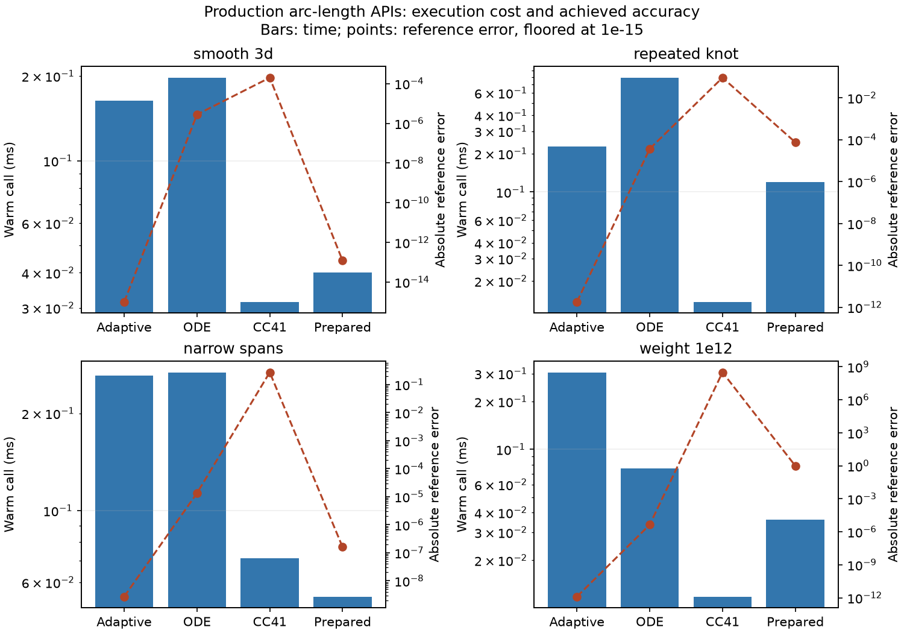
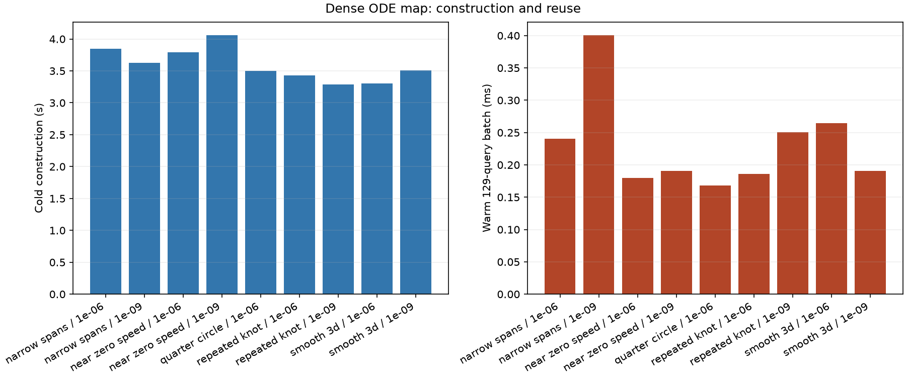

# Production JAX arc-length measurements

Measured on 27 October 2026 at revision `1dcc173`, before the API naming and
dispatcher cleanup. Timing values were not rerun for that API-only refactor;
the original measured-source fingerprints remain intact. API names below use
the current spelling. Every timed operation calls production
`nurbspy.jax`; there are no development integration/inverse implementations.
Raw JSON includes environment and measured-source fingerprints. Comparisons
are between production alternatives at that revision, not a re-created algorithm.

## Implemented behavior

- `get_arclength()` defaults to adaptive knot-aware quadrature, with separate
  `atol`/`rtol`, `tol=1e-6` convenience, direct/Leibniz differentiation and optional
  diagnostics. Scalar calls raise on unsuccessful status.
- `get_arclength()` dispatches statically to `get_arclength_quad_adaptive()`,
  `get_arclength_quad_fixed()` or `get_arclength_ode()`. Method-specific options
  are checked by the selected method. Fixed quadrature uses `n_points`, not a
  tolerance; the ambiguous former method name has been removed.
- `prepare_arclength()` supplies optional Gauss/basis tables for changing P/W;
  their resolution requires validation on the intended design family.
- Dense reciprocal ODE maps use independent normalized knot-span solves, exact
  endpoint anchors and sampled regularity/monotonicity checks. Queries perform
  interpolation only. No epsilon hides a reciprocal singularity.

Quadrature calculates total/partial length $S(u)=\int_{u_0}^u \|C'(t)\|\,dt$; the ODE
supplies repeated $u(s)$ queries. The map supports AD on regular curves and must
be rebuilt after geometry changes.

## Protocol

CPU float64, native-library thread limits, disabled persistent caches, serial
fresh workers and synchronized outputs. Imports, interpreter startup, curve
construction and independent references are outside kernel timings. Cold totals
include preparation, trace/lower, compilation and first execution; warm values
are medians [min,max]. One worker per cell does not capture all run-to-run
clock/compiler variation. Requested controls do not establish equal accuracy.

The length ODE allows 4,096 steps. Dense maps allow 512 steps per knot span and
force at least 16 per span; storage scales with span count. Map construction
includes quadrature, compilation, ODE solves and validation. Query compilation
is separate. Cached rebuilds reuse the same geometry and loaded code caches.

References use independent homogeneous SciPy splines and knot-split QUADPACK,
plus analytic cases. Round trips use independent partial lengths; unit speed
uses finite differences of returned maps. Knot-crossing stencils and low-speed
probes are excluded. Sampled validation is not a global certificate.

## Smooth length: cold stages and execution

First and warm columns are milliseconds; other timing columns are seconds. Fixed rules have no requested tolerance.

| Method / comparison control | Prep s | Trace s | Compile s | First ms | Cold total s | Warm ms [min,max] | Abs. error |
| --- | --- | --- | --- | --- | --- | --- | --- |
| Adaptive quadrature / 1e-06 | 0 | 0.352 | 0.907 | 2.84 | 1.26 | 0.163 [0.147, 0.288] | 8.88e-16 |
| Adaptive quadrature / 1e-09 | 0 | 0.37 | 0.906 | 2.6 | 1.28 | 0.165 [0.134, 0.5] | 8.88e-16 |
| Fixed global CC41 / 1e-06 | 0 | 0.0886 | 0.0679 | 1.59 | 0.158 | 0.0315 [0.0298, 0.152] | 0.000199 |
| Knot-aware ODE / 1e-06 | 0 | 0.805 | 0.697 | 1.67 | 1.5 | 0.197 [0.183, 0.364] | 2.78e-06 |
| Knot-aware ODE / 1e-09 | 0 | 0.756 | 0.713 | 2.67 | 1.47 | 0.62 [0.605, 0.891] | 7.69e-10 |
| Prepared span GL16 / 1e-06 | 0.171 | 0.0275 | 0.0314 | 1.34 | 0.231 | 0.04 [0.0366, 0.139] | 1.23e-13 |

## Length robustness

Error / warm milliseconds at comparison control `1e-6`; unsuccessful status is retained.

| Case | Adaptive | ODE | Fixed CC41 | Prepared GL16 |
| --- | --- | --- | --- | --- |
| collapsed | 0 / 0.0996 | 0 / 0.0501 | 0 / 0.0689 | 0 / 0.0374 |
| narrow_spans | 2.74e-09 / 0.262 | 1.34e-05 / 0.268 | 0.274 / 0.0711 | 1.62e-07 / 0.0542 |
| quarter_circle | 2.22e-16 / 0.283 | 3.63e-07 / 0.0526 | 0 / 0.0366 | 0 / 0.0368 |
| rational_stress | 1e-10 / 1.24 | 1.58e-05 / 1.81 | 0.393 / 0.0143 | 0.419 / 0.0523 |
| repeated_knot | 1.79e-12 / 0.229 | 3.67e-05 / 0.79 | 0.0909 / 0.0137 | 7.55e-05 / 0.119 |
| smooth_3d | 8.88e-16 / 0.163 | 2.78e-06 / 0.197 | 0.000199 / 0.0315 | 1.23e-13 / 0.04 |
| smooth_partial | 4.44e-16 / 0.289 | 1.44e-06 / 0.198 | 4.49e-05 / 0.0122 | 8.88e-15 / 0.0387 |
| weight_1e12 | 1.28e-12 / 0.306 | 4.35e-06 / 0.076 | 3.13e+08 / 0.0118 | 1 / 0.036 |
| weight_1e16 | 1.72e-05 / 0.248 (solver_failure) | 4.28e-06 / 0.085 | 3.13e+12 / 0.0878 | 1 / 0.0379 |

## Eight changing-design value/gradient evaluations

Both P and positive W change. Independent loss checks cover all eight designs outside timers; the base directional gradient uses an independent central difference.

| Method | Cold total s | One warm ms | Eight designs ms [min,max] | Gradient rel. error | Max design loss error |
| --- | --- | --- | --- | --- | --- |
| Adaptive quadrature | 4.61 | 4.79 | 33 [26.2, 45.7] | 1.34e-10 | 1.04e-16 |
| Adaptive + Leibniz AD | 6 | 1.92 | 8.29 [7.61, 10.4] | 1.34e-10 | 1.04e-16 |
| Knot-aware ODE | 6.54 | 4.22 | 38 [33.9, 65.3] | 4.45e-08 | 5.73e-11 |
| Prepared span GL16 | 0.298 | 0.0467 | 0.377 [0.335, 1.19] | 1.39e-10 | 5.75e-15 |

## Dense ODE maps

Warm batches contain 129 queries. Round-trip and unit-speed errors are independent of the total-length check.

| Case / control | Construction s | Query trace s | Query compile s | First ms | Warm batch ms [min,max] | Cached rebuild+batch ms | Length error | Round-trip error | Unit-speed FD error | Status |
| --- | --- | --- | --- | --- | --- | --- | --- | --- | --- | --- |
| endpoint_zero_speed / 1e-06 | — | — | — | — | — | — | — | — | — | expected_rejection |
| interior_zero_speed / 1e-06 | — | — | — | — | — | — | — | — | — | expected_rejection |
| narrow_spans / 1e-06 | 3.84 | 0.102 | 0.132 | 0.904 | 0.241 [0.154, 0.558] | 209 | 1.07e-13 | 2.64e-05 | 0.00149 | ok |
| narrow_spans / 1e-09 | 3.63 | 0.154 | 0.134 | 1.56 | 0.401 [0.264, 0.726] | 193 | 0 | 2.23e-07 | 9.86e-06 | ok |
| near_zero_speed / 1e-06 | 3.79 | 0.128 | 0.159 | 0.705 | 0.179 [0.153, 0.245] | 199 | 0 | 1.44e-05 | 0.000845 | ok |
| near_zero_speed / 1e-09 | 4.06 | 0.092 | 0.144 | 0.711 | 0.191 [0.185, 0.236] | 183 | 0 | 1.03e-07 | 1.53e-05 | ok |
| quarter_circle / 1e-06 | 3.5 | 0.11 | 0.13 | 0.615 | 0.168 [0.134, 0.638] | 194 | 0 | 8.89e-08 | 2.75e-06 | ok |
| repeated_knot / 1e-06 | 3.43 | 0.125 | 0.171 | 0.534 | 0.186 [0.169, 0.52] | 206 | 1.99e-13 | 9.75e-06 | 0.00124 | ok |
| repeated_knot / 1e-09 | 3.28 | 0.108 | 0.125 | 0.703 | 0.25 [0.194, 0.785] | 218 | 3.38e-14 | 1.74e-07 | 1.07e-05 | ok |
| smooth_3d / 1e-06 | 3.31 | 0.116 | 0.118 | 0.87 | 0.264 [0.188, 0.531] | 210 | 8.88e-16 | 2.78e-06 | 0.000118 | ok |
| smooth_3d / 1e-09 | 3.51 | 0.141 | 0.158 | 1 | 0.19 [0.171, 0.627] | 210 | 8.88e-16 | 5.35e-08 | 3.79e-06 | ok |
| stationary_span / 1e-06 | — | — | — | — | — | — | — | — | — | expected_rejection |

## Failures and explicit rejections

| Case | Method / control | Status | Reason/diagnostic |
| --- | --- | --- | --- |
| weight_1e16 | adaptive / 1e-06 | solver_failure | {'value': 1.000017200411308, 'error_estimate': 0.09292463965951947, 'evaluations': 441, 'status': 6, 'intervals': 20} |
| endpoint_zero_speed | dense_ode / 1e-06 | expected_rejection | Sampled stationary/flat speed; reciprocal ODE requires positive speed. |
| interior_zero_speed | dense_ode / 1e-06 | expected_rejection | Sampled stationary/flat speed; reciprocal ODE requires positive speed. |
| stationary_span | dense_ode / 1e-06 | expected_rejection | Sampled stationary/flat speed; reciprocal ODE requires positive speed. |

## Numerical and maintenance limits

Adaptive quadrature is the general length method. Fixed/prepared rules are
useful for validated repeated-design families, but can badly underresolve
rational layers. Extreme weight failures remain visible; more workspace does
not cure floating-point resolution and error estimators are not certificates.

Dense queries remain interpolation-only. This regular-curve API rejects sampled
stationary speed and flat spans. An isolated stationary point can have a unique
continuous inverse with infinite derivative; a flat span has no unique ordinary
inverse. Those cases require a separately designed policy.

Near small speed, $|\Delta u|\lesssim\frac{|\Delta s|+\text{integration error}}{v_{\min}}$.
Local ODE controls do not certify global inverse or unit-speed error. Refine
tolerances/dense resolution for sensitive applications. Both geometry and query
sensitivities have analytic regressions; the norm's zero subgradient does not
make collapsed-curve length differentiable.

Retain this single production benchmark for future package/compiler maintenance.
Ordinary tests check values, interval contracts, failures, prepared tables,
independent map round trips/actual unit speed and AD, with no timing thresholds.
See the [usage guide](../../docs/source/getting_started/jax_arclength.md) and
[README](README.md) for assumptions and commands.

## Validation

| Check | Outcome |
| --- | --- |
| Python 3.13 full suite | 466 tests; 0 failures/errors |
| Python 3.12 full suite | 466 tests; 0 failures/errors |
| Documentation | Sphinx build passed with warnings treated as errors |
| Installed wheel | Combined-extras isolated smoke check passed; adaptive/prepared exports included |
| Wheel contents | Production arc-length module included; no development payload |
| Final interface checks, Python 3.13 | 25 passed; 0 failures/errors |
| Final guards checks, Python 3.13 | 2 passed; 0 failures/errors |
| Final interface checks, Python 3.12 | 25 passed; 0 failures/errors |
| Final guards checks, Python 3.12 | 2 passed; 0 failures/errors |
| Measured runtime-source fingerprints | 60 cells verified against revision 1dcc173 before API naming/dispatcher cleanup; original snapshots preserved |
| Recorded outcomes | 56 completed calls, 3 expected regularity rejections, 1 explicit extreme-weight solver failure; achieved accuracy is reported separately |
| API dispatcher refactor, Python 3.13 | 64 relevant correctness/JIT/AD tests passed; original timing values not rerun |
| API dispatcher refactor, Python 3.12 | 4 focused static-dispatch/JIT/AD/option-validation tests passed |
