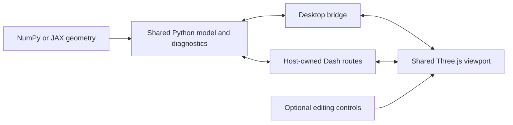

# Viewer/editor behaviour on main

Ported from the reviewed experimental working tree on 7 November 2026.
This is the current interface contract. The implementation preserves main's
Point inputs, YAML serialization, numerical methods, and external STL pipeline.
Undo/redo and viewer file dialogs are intentionally omitted. Save/load remain
ordinary Python methods. No GUI automation was used during this port.

## 1. Shared architecture

There is one Python geometry model, one JavaScript viewport, an optional editing
capability, and two host adapters:



- Python nurbspy evaluates NURBS coordinates, derivatives, scalar quantities,
  Frenet frames, and constraint normals. This logic is not reimplemented in JS.
- Three.js handles rendering, camera navigation, picking, and ray/constraint
  interaction. Editing changes control-point coordinates/weights, then asks Python
  to evaluate the resulting geometry.
- Read-only viewing is the same viewport without the editing capability.
- Desktop and embedded versions share colours, handle sizes, navigation, display
  controls, inspectors, and editing logic.
- Numerical objects contain thin convenience methods. GUI code lives in the
  `visualization/` subpackage and shared `web_assets/` modules.
- The older Plotly application and assembly viewer were not ported; the shared
  viewport has no Plotly dependency.

## 2. Public entry points and ownership

| Purpose | Desktop | Embedded in a Dash application |
| --- | --- | --- |
| Read-only inspection | `geometry.show()` | `GeometryView(geometry, id=...)` |
| Editing | `geometry.edit()` | `GeometryEditor(geometry, id=...)` |
| Matplotlib figure/axes | `geometry.plot(...)` | Existing Matplotlib integration |

The function-oriented API is also available:

```python
from nurbspy.visualization import GeometryView, GeometryEditor, plot, show, edit

show(geometry)
edited = edit(geometry)
figure, axes = plot(geometry)
show(geometry, backend="matplotlib")
```

### Desktop lifecycle

- Opens a native pywebview window using self-contained assets and a direct Python
  bridge. It starts no Dash/Flask application or HTTP asset server and does not
  launch an external browser.
- Calls are blocking and must run on Python's main thread.
- `show()` returns `None` after the window closes.
- `edit()` starts from an independent geometry copy. Apply returns a new native
  **NumPy** geometry; Cancel or closing the window returns `None`.
- JAX inputs are copied to the host; the current return policy is NumPy, not a
  reconstructed JAX object. Interaction is outside JIT/autodiff.
  During the port, preserve a single UI and keep backend conversions/reconstruction
  behind its adapter. Verify and document return types; this does not call for a
  separate JAX viewer or a JavaScript numerical implementation.
- Original input objects are not mutated. Degrees, knots, and control-net shape
  remain fixed while editing.
- Apply waits for committed geometry evaluation; invalid geometry is rejected.
- Escape closes an open inspector first when focus is inside the viewport widget.
  With no inspector open, the native host handles Escape as cancellation.
- The current desktop API does not provide non-blocking or coordinated multi-window
  editing. Those are separate features.

### Embedded lifecycle

- The host owns its Dash app, page layout, server, authentication, and project state.
- Mount `.layout`, call `.register(app)` once during setup, and use unique IDs.
- `GeometryEditor` extends `GeometryView`; they share the adapter implementation.
- Accepted full-quality models are published to `component.state_id` after the
  pending edit queue drains. Transient previews do not trigger that publication.
- `geometry_from_state(state)` reconstructs a native NumPy object for host analysis.
- Browser sessions hold independent model state; there is no global mutable
  current geometry. The original Python input remains unchanged.
- Read-only components omit the Edit button, Reset, edit store, edit callback, and
  HTTP edit endpoint. Camera, display, diagnostics, and coordinate inspection remain.
- A Flask-only public mounting helper is not implemented. The current embedded
  adapter is Dash, using the host's Flask server.

## 3. Geometry and input contract

- One spatial geometry model is used for curves and surfaces.
- Older two-coordinate inputs are copied and promoted to $z=0$ at the viewer
  boundary. Editing returns three-coordinate geometry. This does not remove the
  numerical package's support for native 2D arrays.
- The interactive model accepts finite real coordinates and finite positive
  weights. Complex and arbitrary-dimensional numerical use cases remain outside
  the interactive boundary and must continue working in the core package.
- Curves retain coordinate-first arrays; surfaces retain coordinate-first tensor
  nets. Point convenience inputs on main normalize into those arrays before viewing.
- Direct coordinate and weight editing does not change degrees, knots, topology,
  or the number of control points. Insertion/deletion is not implemented.

## 4. Initial appearance and handle rendering

| Element | Default |
| --- | --- |
| Geometry colouring | Solid; colormaps are opt-in |
| Curve | Black, using wide-line rendering |
| Surface | Blue, with lighting for solid rendering |
| Control points and polygon/net | Orange |
| Selected control point | Green |
| Background | White |
| Reference grid | Visible, subdued, behind geometry |
| Spatial projection/navigation | 3D perspective / Arcball |
| Ticked axes | Off until enabled in an orthographic view |
| Surface boundaries / control polygon | Visible |
| Scalar field / Frenet frames / export mesh | Off in the base defaults |

The seven current demos start in solid colour. Some demos deliberately enable
an orthographic projection, ticked axes, or display mesh to illustrate those
features; these are script settings, not global defaults.

- Orthographic handles are white-filled circles with coloured outlines. Their
  nominal radius is 4.5 CSS pixels; the outer ring extends to 1.08 times that.
- Spatial handles are glossy spheres. Their apparent outer size matches the
  orthographic handles, using per-point camera depth, projection scale, and zoom.
- Selected handles are 15 percent larger in both modes.
- Handle sizing is updated in the shared render path, not independently by fit,
  selection, and geometry-update handlers.
- Handles render above the control polygon/net and geometry. The grid renders
  in a separate background pass, followed by depth clearing and the geometry pass.
- Standalone 3D axis arrows are absent from the main plot. The small orientation
  triad belonging to the ViewCube is retained.
- Curve and boundary lines use approximately 2.6 CSS-pixel width.

## 5. Header and inspectors

The header order is title, Navigation dropdown, Fit, optional Reset, Display,
and optional Edit. Camera actions and inspector buttons are grouped; flex layout
wraps controls onto additional rows in narrow windows or embedded containers.

- Display and Edit are ordinary horizontal buttons, not rotated edge tabs.
- Each opens its right-hand inspector. Clicking the active button closes it.
- The open pane's button has a subtle tint and exposes its expanded state.
- A close button and Escape also close the pane and return focus to its header button.
- Only one pane is open at a time. Switching or closing panes preserves settings,
  geometry, selection, and camera orientation. Pane resizing does not fit the model.
- Each inspector group can be collapsed independently; the pane scrolls if needed.
- Read-only mode has Display, but no Edit or Reset.
- The Python/nurbspy badge, repeated Position paragraph, and application-analysis
  midpoint/weight-range readout have been removed.
- Edit contains the controls without instructional paragraphs. Readiness,
  validation errors, selected coordinates, and evaluation status use the status area.

## 6. Navigation and projections

The 3D Navigation dropdown offers:

| Mode | Behaviour |
| --- | --- |
| Arcball | Rotation around a virtual sphere; default |
| Orbit | Turntable rotation about the current up direction |
| Trackball | Free camera-relative tumbling without inertia |

Changing navigation mode preserves camera position, orientation, zoom, and focus.
Background dragging navigates; dragging a handle edits. Right-drag pans and the
wheel zooms. Fit reframes the complete control net.

Projection choices are 3D perspective, X–Y, Y–Z, and Z–X. Orthographic views are
projections of the same spatial model, not separate native 2D geometry renderers.

- Orthographic views lock rotation and mouse editing to the selected plane.
- Dragging preserves the hidden coordinate. Direct coordinate fields can still
  explicitly change any of X, Y, and Z.
- Optional axes provide tick marks, numeric labels, coordinate names, and a grid
  linked to pan and zoom. Ticked axes are not currently provided in perspective.
- The Navigation dropdown and ViewCube are hidden in orthographic views.
- Changing projection fits the geometry in the new camera; the previous 3D
  navigation choice is remembered. Full camera framing is not stored per projection.

### ViewCube

- Adapted from the turbomoc design, with six face, twelve edge, and eight corner
  orientation targets and a camera-linked orientation display.
- Face/edge/corner snaps preserve focus and camera distance/zoom.
- Arrows orbit or roll; HOME restores the configured initial direction, and ISO
  chooses an isometric direction. Fit remains a separate action.
- Keyboard controls include arrows, Q/E for roll, Home, and I for isometric.
- Smooth transitions respect reduced-motion preferences. Mouse interaction can
  interrupt a transition without the next navigation event undoing the orientation.

## 7. Edit behaviour

### Selection and coordinates

- Pick a handle or use the control-point dropdown. The dropdown also provides
  access to overlapping handles.
- Fields are named **X coordinate**, **Y coordinate**, and **Z coordinate**.
- Enter or completing a changed field commits a full-quality Python evaluation.
- Blank and nonfinite values are rejected. Re-entering the current value does
  not create another commit. An active field is not overwritten during typing.
- The same setter updates both curve and surface array layouts for dragging and
  numeric changes. Scientific model values retain float64 precision; float32 is
  used for display vertex transport.

### Drag constraints

- In 3D: View plane, XY plane, XZ plane, YZ plane, X axis, Y axis, Z axis, and
  **Normal direction**.
- Coordinate-axis constraints preserve the other coordinate components. Plane
  constraints preserve their perpendicular component.
- During a drag, camera manipulation is disabled for that pointer and restored
  on release. Geometry evaluation uses reduced-detail previews, then full quality.
- Near a view-aligned constraint axis, rotate the camera to make movement visible.
- Orthographic projections retain their plane lock and disable the 3D constraint
  selector. Returning to 3D restores its previous constraint choice.

### Normal direction

A control point generally does not lie on the curve or surface. The implementation
therefore associates it with a parameter location, rather than claiming there
is a unique geometric normal at the control point itself.

- The association uses Greville parameters, clamped to the active knot domain:
  $u_i=(U_{i+1}+\cdots+U_{i+p})/p$, with the tensor-product counterpart for surfaces.
- Python evaluates the curve's Frenet normal or the surface normal at that location.
- The direction is copied at drag start and remains fixed for the complete drag.
  It is refreshed from the updated model afterward. There is no moving-axis
  feedback loop during manipulation.
- Normals are fetched only for this constraint, with one request in flight per
  editor, a ten-second timeout, and selection/generation checks against stale replies.
- Select the point and wait for normal readiness before starting the drag. An
  initial click on a different point may require waiting before dragging again.
- Straight/zero-curvature curves, degree-zero directions, insufficiently smooth
  knot joins, and singular surface points can have no defined normal. The UI reports
  this and does not invent a fallback direction.
- Normal-direction dragging is currently **3D only**. Using a curve normal in an
  orthographic plane, where it lies in that plane, would be an additional feature.

### Weights and Reset

- A logarithmic positive-weight slider spans 0.01 to 100. A numeric field accepts
  finite positive weights up to 1,000,000.
- Slider motion produces previews; release/confirmation requests full quality.
- Weights are separate properties from control-point coordinates.
- Reset restores the initial control points and weights and selects the first
  point. It does not reset the camera or display configuration.
- Undo/redo is **not implemented**. Reset is not a substitute for undo history.

Undo would restore the state before the last completed edit, for example moving
a point back to its position before the last drag. Redo would apply that edit
again. Conventional shortcuts are Ctrl+Z and Ctrl+Y (or Ctrl+Shift+Z). A whole
drag should be one action, not a history entry per mouse event. This is distinct
from Reset, which restores the complete starting geometry. It is optional for
the first integration unless explicitly included in the implementation scope.

### Native geometry saving and loading

Main already provides `to_yaml()` and `from_yaml()` on its geometry classes.
Retain these as code-level functionality, including their current metadata,
dtype, and NumPy/JAX handling. A returned edited geometry can be saved by the
calling script, and a script can load geometry before opening the viewer.
No Save/Open pane, dialog, or additional viewer-specific format is required.

## 8. Display controls and diagnostics

Groups are ordered View, Geometry, Control points, Scientific colouring, and
Surface mesh or Frenet–Serret frames.

- View: projection, optional ticked axes, and reference grid.
- Geometry: solid colour picker and optional surface boundary curves.
- Control points: polygon/net visibility, shared point/polygon colour, and
  independently configurable selected-point colour.
- Restore default colours restores all three colour choices.
- The control-polygon toggle hides net lines, not the point handles. An independent
  hide-handles option is not currently implemented.

| Curves | Surfaces |
| --- | --- |
| Curvature | Mean curvature |
| Torsion | Gaussian curvature |
| Cumulative arc length | Minimum/maximum principal curvature |
| Parameter speed | Parameters u and v |
| Parameter u | |

Parameter speed is $\|dC/du\|$, not a physical velocity. Cumulative arc length
uses numerical quadrature on a dense knot-aware grid. Curvature signs depend on
orientation. Units are relative to the model's coordinate units.

- Colormaps: viridis, plasma, magma, inferno, cividis, coolwarm, and RdBu.
- Users can reverse a map, choose automatic limits, or set manual limits.
- A colour bar shows the quantity, units, and range. Constant fields get a nonzero
  display range. Undefined values are grey instead of fabricated zeros.
- Scalar-coloured surfaces use unlit rendering so lighting does not distort the
  numerical colour scale; solid surfaces retain lighting.
- Only requested diagnostics are calculated. A coalescing inspection queue and
  revision checks prevent stale results replacing newer choices. Automatic limits
  are held during a drag and refreshed at full quality.
- Curve Frenet frames are opt-in, sampled at approximately equal arc-length spacing,
  with frame count and arrow scale controls. Undefined frames are omitted.

## 9. Mesh preview and STL

There are deliberately two mesh views:

1. **Display mesh:** the responsive rendering triangles, using viewer sampling.
2. **STL export mesh:** an on-demand export tessellation and processing result.

Selecting STL export mesh generates the preview and STL in memory. A separate
Download STL action saves the result. U/V sample counts are configurable from 2
to 160. Export preview uses solid colour and suspends scalar colouring; returning
to the display mesh or None restores the selected diagnostic workflow.

The preview and download use the externally processed mesh. Display mesh
triangulation can differ; exact preview/file triangle identity is not an API requirement. Edits invalidate the cached export and disable download until it is
regenerated. Mesh generation waits for drag release. Read-only viewers can inspect
and export surfaces without enabling geometry editing.

### External exporter on main

The current `analysis.export_preview` uses the shared external processing operation in
`mesh.py`. Both `export_stl` and `export_stl_bytes` use this same Trimesh/NetworkX
pipeline. The prototype's custom mesh writer was not ported.

The export contract is:

- Reuse main's surface sampling adapter and external mesh-processing/writing path.
- Adapt the download/preview integration to the external exporter as appropriate.
  The displayed mesh and exported file may differ in sampling or processing;
  label them accurately. Do not duplicate repair rules or preserve a second writer.
- Preserve main's welding, winding, non-manifold, closure, and float32 checks.
- Preserve unitless STL semantics. An open NURBS patch remains an open mesh unless
  the application supplies a complete shell. Do not promise automatic hole filling,
  trimming, self-intersection repair, or printable-solid certification.
- Closed export supports one connected shell and rejects nested
  or disconnected shells. The viewer must propagate these constraints honestly.

The torus/oloid printing demonstration remains separate. The new shared viewport
currently edits one curve or one surface; it is not a multi-patch assembly editor
and does not enforce seam continuity between independent patches.

## 10. Responsiveness, data integrity, and dependencies

- Geometry/material/GPU buffers are reused; rendering is coalesced to animation frames.
- One edit evaluation is in flight, with only the latest pending edit retained.
- Local generations and request revisions prevent old results overwriting new input.
- Full accepted geometry is published separately from transient previews.
- Edit evaluations have a thirty-second timeout and rollback on rejection/failure.
  A timeout does not necessarily cancel work already executing in Python.
- Diagnostic and normal requests have separate stale-result handling. Native
  scientific computation remains Python, even while camera motion is client-side.
- Cached sampling locations and topology are present. This is not a claim that the
  full prepared-basis reuse described by main roadmap item 11 is implemented.
- Disposal removes observers, listeners, requests, navigation controls, and GPU resources.
- Optional extras are `desktop` (pywebview) and `web` (Dash). The older prototype `viewer` extra was not ported. Base numerical use should not require a GUI.
- Desktop assets are local/self-contained, with no CDN requirement. The bootstrap
  handles WebView2's HTML size limit and requires a modern engine with import maps
  and gzip `DecompressionStream`. Vendor licenses/manifest must ship with the wheel.

## 11. Current examples

All settings and geometry are defined in readable scripts, without CLI arguments
for the current examples.

| Script in `demos/demos_viewer/` | Purpose |
| --- | --- |
| `demo_curve_view.py` | Native read-only curve |
| `demo_curve_edit.py` | Native curve editor; prints accepted coordinates/weights |
| `demo_surface_view.py` | Native read-only surface |
| `demo_surface_edit.py` | Native surface editor; prints accepted coordinates/weights |
| `demo_embedded_curve.py` | Host-owned curve editor, port 8061 |
| `demo_embedded_surface.py` | Host-owned surface editor, port 8062 |
| `demo_embedded_surface_view.py` | Host-owned read-only surface, port 8063 |

`_embedded_app.py` is support code, not a launcher. Duplicate desktop/combined
embedded launchers were removed. Older Plotly curve/surface examples live in
the experimental checkout and were not ported. The existing main
`demos/demos_surfaces/demo_stl_printing.py` remains the torus/oloid multi-patch
export example using the external exporter.


## Scope and validation

This first integration includes the common renderer and optional desktop/web
adapters. Geometry editing returns a NumPy host object even for JAX inputs;
YAML restores through either backend. Numerical methods remain unchanged and
legacy Matplotlib signatures are retained through shared visualization functions.
The primary interactive entry points and examples use `show()` and `edit()`.

Windows bootstrap, lifecycle, framework-free import, backend, coordinate,
normal, export, and frontend contracts are covered by automated checks.
The latest visual refinements were tested without taking control of the computer.
macOS/Linux native UI is not claimed as interactively verified. See
[the main port report](MAIN_PORT_REPORT.md) for exact validation results.
