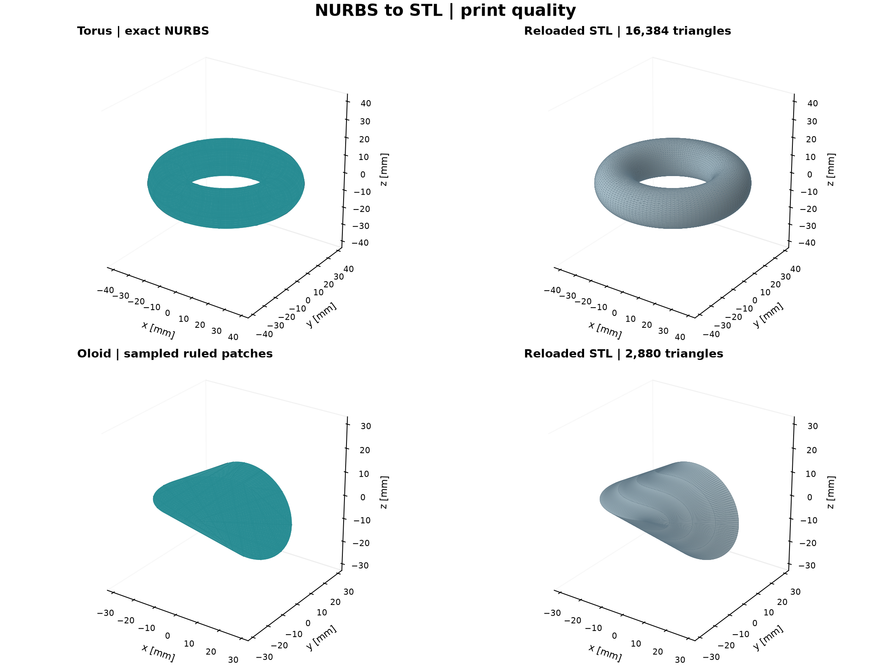

# Torus and oloid: from NURBS to a printable STL

This example constructs two objects with native nurbspy classes, exports binary
STL files, checks the reloaded meshes, and plots the NURBS models beside the
triangles actually stored in those files. Trimesh and NetworkX are standard
nurbspy dependencies; no viewer or additional mesh installation is needed.

## Run the example

From the repository root:

```bash
python demos/demos_surfaces/demo_stl_printing.py
```

The default `print` preset writes `torus_print.stl`, `oloid_print.stl`, and
`stl_printing_print.png` under `output/stl_printing/`, then opens a Matplotlib
window with all four panels. Export happens before the window opens.

```bash
# Fast, visibly coarser mesh:
python demos/demos_surfaces/demo_stl_printing.py --quality preview

# Finer mesh, save the figure without opening a window:
python demos/demos_surfaces/demo_stl_printing.py --quality fine --no-show

# Choose another output directory:
python demos/demos_surfaces/demo_stl_printing.py --output-dir my_stl_files
```

Run using the environment in which this checkout of nurbspy is installed.
`--no-show` still generates the comparison PNG. Plotting uses the package's
`plot_surface()` and isocurve methods for the NURBS models; the right-hand panels
plot the reloaded STL triangles.



## Geometry and dimensions

**Torus.** `make_torus(major_radius=30, minor_radius=10)` makes an exact rational
circular profile with `CircularArc`, then revolves it through $2\pi$ with
`NurbsSurfaceRevolution`. Radii are in millimetres. The major radius is the distance
from the rotation axis to the tube centreline; the minor radius is the tube radius.
The resulting dimensions are $80\times80\times20$ mm. Keep $R>r>0$ for a ring torus.
Here $u$ follows the revolution and $v$ follows the tube profile.

**Oloid.** `make_oloid(radius=20, boundary_points=181)` uses equal-radius circles
in perpendicular planes, whose centres are one radius apart. Paired contact
points define two native `NurbsSurfaceRuled` patches. The approximate dimensions
are $60\times40\times40$ mm. The boundaries are sampled degree-one NURBS curves:
this is an approximation to an oloid, not an exact analytic representation.
Dimensions are rounded: for example, the preview mesh spans about 39.9959 mm
in $y$, slightly below the ideal 40 mm.
Here $u$ follows the paired boundary points and $v$ runs along each straight ruling.

The symmetric construction needs an **odd `boundary_points` count of at least
five**. More boundary points improve the underlying curved-boundary approximation.
Increasing export `nu` alone cannot recover curvature missing from those
piecewise-linear boundaries.

## Every tessellation and export control

| Parameter | API default | Meaning and how to choose it |
| --- | --- | --- |
| `nu` | `80` | Integer regular sample count along $u$, at least two. Increase where geometry changes strongly in this direction. Torus: around the major circle. Oloid: along the curved boundaries. |
| `nv` | `30` | Integer regular sample count along $v$, at least two. Torus: around the tube. Oloid: across the straight rulings, where fewer samples are normally needed. Bilinear cells can still be slightly warped, so check refinement rather than assuming every quad is planar. |
| `require_closed` | `False` | Export-only switch. Set **`True` for these solid-printing examples**. Rejects open edges and requires consistent winding, positive volume, and one face-connected shell. It does not cap openings or detect self-intersections. |
| `weld_tolerance` | `None` | Export-only approximate seam-merging length in the same units as the coordinates. `None` selects $10^{-10}$ times the largest extent. It controls vertex merging, **not geometric approximation accuracy**. |
| `path` | Required | Output `.stl` path. The exporter writes binary STL and returns a `Path`. The demo creates its output directory first. |

`surface.tessellate(nu=..., nv=...)` and
`nrb.tessellate_surfaces(patches, nu=..., nv=...)` return NumPy vertices and faces.
They accept only the two sampling controls: welding and closed-shell checks belong
to export. Knot breaks are included automatically, so the actual number of
samples can exceed the requested regular counts. Before seam/degenerate cleanup,
a grid typically produces $2(N_u-1)(N_v-1)$ triangles per patch. Doubling both
sample counts therefore roughly quadruples the mesh size.

The plotting arguments **`Nu` and `Nv` are capitalized** and independent of the
lowercase export arguments. In the demo, native model plots use `Nu=73, Nv=41`;
changing those values changes the display, not the STL.

### Choose the settings explicitly

For a single torus surface:

```python
torus = make_torus(major_radius=30, minor_radius=10)
vertices, faces = torus.tessellate(nu=129, nv=65)  # inspect without writing
path = torus.export(
    "torus.stl",
    nu=129,
    nv=65,
    require_closed=True,
    weld_tolerance=None,
)
```

For the two-patch oloid, use the shared multi-patch exporter so that it can merge
the seams and validate the complete object:

```python
patches = make_oloid(radius=20, boundary_points=181)
path = nrb.export_stl(
    patches,
    "oloid.stl",
    nu=181,
    nv=5,
    require_closed=True,
    weld_tolerance=None,
)
```

These snippets use the builders from the example script and `import nurbspy as nrb`.
The script's `QUALITY` dictionary is the single place to change preset sampling
and oloid boundary density.

### Seam merging is different from mesh accuracy

Keep `weld_tolerance=None` initially. Its default is about $8\times10^{-9}$ mm
for the torus and $6\times10^{-9}$ mm for the oloid: intended for numerical seam
noise, not manufacturing gaps. If independently generated, otherwise compatible
seams differ by tiny round-off errors, an explicit value such as
`weld_tolerance=1e-7` mm can be tried after checking the actual gap. Keep it much
smaller than the smallest feature and mesh-edge spacing that must survive.
Increasing it indiscriminately can merge real features.

Trimesh merges using decimal rounding of normalized coordinates. Consequently,
this value is an approximate rounding scale, not a guaranteed Euclidean merge
radius. Values must be at least $10^{-15}$ times the object's largest extent and
smaller than that extent. Corresponding patch boundaries still need matching
sample locations; this parameter cannot repair incompatible parameterizations
or missing faces.

## Presets and observed mesh sizes

These are starting points for the dimensions above, not a printer accuracy guarantee.

| Preset | Torus `nu, nv` | Oloid boundary points | Oloid `nu, nv` | Torus triangles | Oloid triangles |
| --- | --- | --- | --- | --- | --- |
| `preview` | 33, 17 | 61 | 61, 3 | 1,024 | 480 |
| `print` | 129, 65 | 181 | 181, 5 | 16,384 | 2,880 |
| `fine` | 257, 129 | 361 | 361, 9 | 65,536 | 11,520 |

The default STL sizes are about 800 KiB and 141 KiB. The script prints actual
triangle counts, file sizes, bounding dimensions, and enclosed volume after reload.
The torus has analytic volume $2\pi^2Rr^2\approx59{,}217.6$ mm$^3$; observed STL
volumes were about 57,327.9, 59,098.0, and 59,187.7 mm$^3$ for the three presets.
The progression gives a useful convergence check, but volume agreement alone
does not bound local surface error.

Start with `preview` to inspect orientation and shape. Compare `print` with
`fine`, checking silhouettes, critical dimensions, and small features against
your required tolerance. Count-based tessellation is not adaptive and has no
chord-error setting. A larger or more curved model may need more samples than
these examples. For the oloid, refine boundary points as well as export sampling.

## Importing into a slicer

STL carries **no units**. These examples use millimetre-sized coordinates; select
millimetres on import and check the dimensions above. Layer height, nozzle size,
infill, print orientation, and support generation are slicer settings, not
nurbspy tessellation controls. A closed mesh does not establish that a particular
orientation can be printed without supports.

The examples verify watertightness and positive volume after reading the files
back, but do not perform general self-intersection checks. Export validation
supports one connected shell; separate solids should be exported separately,
and nested cavity shells are not supported by `require_closed=True`. STL uses
float32 coordinates, so keep objects near the origin and avoid coordinate offsets
that overwhelm small features.

## Complete script

```{literalinclude} ../../../demos/demos_surfaces/demo_stl_printing.py
:language: python
```
